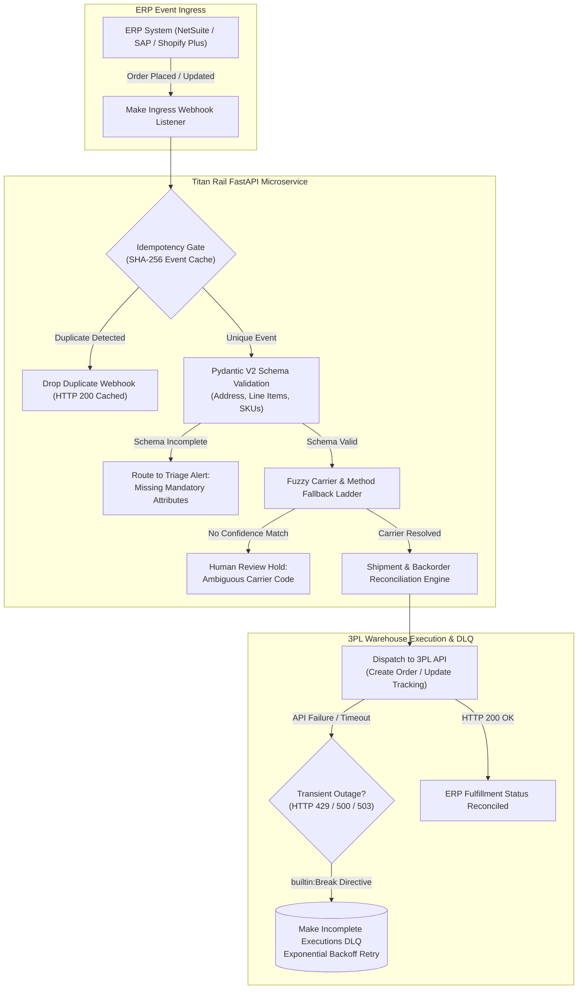

<p align="center">
  
</p>

<p align="center">
  <strong>Enterprise-Grade Resilient ERP-to-3PL Logistics Engine with Make.com Dead-Letter Queues &amp; FastAPI Decision Gateway</strong>
</p>

<p align="center">
  <a href="https://www.linkedin.com/in/akashjadon"></a>
  <a href="https://github.com/akashjadon04"></a>
  
  
  
</p>

---

## ⚡ Executive Summary

Modern enterprise logistics relies on tight integration between Enterprise Resource Planning (ERP) databases (such as NetSuite, SAP, or Dynamics) and Third-Party Logistics (3PL) fulfillment warehouses (such as ShipBob, Flexport, or Quiet 3PL). However, standard no-code automations suffer from catastrophic edge-case failures:

1. **Silent Drops on Downstream Downtime**: When a warehouse API experiences HTTP 429 throttling or maintenance downtime, standard iPaaS workflows terminate, losing critical customer orders.
2. **Unmapped Shipping Method Halts**: ERP orders containing new or ambiguous shipping carrier codes crash rigid mapping modules, leaving warehouse pickers idle.
3. **Partial Fulfillment State Drift**: When warehouse shipments split across multiple tracking numbers or encounter backorders, naive automations corrupt line-item inventory counts.

**Titan Rail** provides a hybrid architectural solution: pairing a high-speed **Python FastAPI decision microservice** with **Make.com fault-tolerant scenario blueprints**. By enforcing **Make's native `builtin:Break` dead-letter queues**, fuzzy carrier fallback ladders, and cryptographic webhook deduplication, Titan Rail guarantees zero dropped orders and zero unhandled shipping exceptions.

---

## 🏛️ System Architecture



---

## 💎 Core Architectural Features

| Engine Feature | Implementation Detail | Operational Guarantee |
| :--- | :--- | :--- |
| **Fail-Safe DLQ Routing** | Make `builtin:Break` error directives on external calls | Transient 3PL outages retry with exponential backoff and buffer into Incomplete Executions rather than discarding data. |
| **Strict ERP Schema Validation** | Pydantic V2 model validators (`models.py`, `validation.py`) | Invalid shipping addresses and malformed SKU quantities are isolated with structured diagnostic error traces before dispatch. |
| **Carrier Fallback Ladder** | Multi-tier fuzzy matching algorithm (`mapping.py`) | Matches legacy ERP carrier codes to valid 3PL service levels with fallback confidence scoring. |
| **Cryptographic Deduplication** | SHA-256 payload fingerprinting (`idempotency.py`) | Prevents duplicate carrier webhook deliveries from re-triggering downstream ERP mutation events. |
| **Split-Shipment Reconciliation** | Unit balance calculation engine (`reconcile.py`) | Reconciles partial quantity fulfillments and backordered lines without data desynchronization. |

---

## 📡 Microservice API Endpoints

The Titan Rail decision service runs as a stateless REST microservice:

| Endpoint | HTTP Method | Description |
| :--- | :---: | :--- |
| `/healthz` / `/health` | `GET` | Service readiness probe and active catalog status check. |
| `/orders/validate` | `POST` | Validates ERP order structures against strict enterprise schema constraints. |
| `/map/shipping-method` | `POST` | Maps shipping methods, addresses, and carrier strings into standardized 3PL payloads. |
| `/shipments/reconcile` | `POST` | Reconciles incoming warehouse shipment manifests against open ERP order lines. |
| `/webhook/events` | `POST` | Ingress webhook deduplication engine with atomic SHA-256 event ID caching. |
| `/orders` | `POST` | High-fidelity test sink simulating downstream 3PL order ingestion. |
| `/ops` | `POST` | Operational alert test sink simulating Slack/PagerDuty exception triaging. |

---

## 🧪 Comprehensive Verification & Test Suite

The Python test suite contains **83 automated unit and integration tests** covering every operational edge case:

```bash
# Run the full test suite
pytest

# Test output:
# tests/test_envelope.py .....                     [  6%]
# tests/test_health.py ..                          [  8%]
# tests/test_mapping_api.py .............          [ 24%]
# tests/test_mapping_unit.py ..........            [ 36%]
# tests/test_reconcile.py ..................       [ 57%]
# tests/test_sinks.py ....                         [ 62%]
# tests/test_validation.py .................       [ 83%]
# tests/test_webhook.py ..............             [100%]
# ======================== 83 passed in 0.66s ========================
```

---

## 🚀 Quick Start Guide

### 1. Launch with Docker Compose

```bash
# Clone the repository
git clone https://github.com/akashjadon04/titan-rail.git
cd titan-rail

# Build and start the decision microservice
docker compose up -d
```

The service is available immediately at `http://localhost:8000`. Verify system health:

```bash
curl -s http://localhost:8000/health | jq .
```

### 2. Import Scenario Blueprints into Make.com
1. Open your Make.com organization workspace.
2. Navigate to **Scenarios** -> **Create a new scenario**.
3. Click the **...** menu in the bottom control panel and choose **Import Blueprint**.
4. Select `blueprints/order_export_failsafe.json` or `blueprints/tracking_sync_failsafe.json`.
5. Configure your connection endpoints to point to your live Titan Rail microservice and 3PL provider.

---

## 📂 Repository Structure

```
titan-rail/
├── assets/
│   └── titan-rail-banner.svg         # Architectural header graphic
├── blueprints/
│   ├── README.md                     # Blueprint mapping and import guide
│   ├── order_export_failsafe.json    # Make scenario: ERP order to 3PL export with DLQ
│   └── tracking_sync_failsafe.json   # Make scenario: 3PL tracking to ERP sync
├── docker-compose.yml                # Microservice container definition
├── Dockerfile                        # Multi-stage production container image
├── fixtures/                         # Realistic ERP and carrier test fixtures
├── pyproject.toml                    # Hatchling build metadata & dependencies
├── src/
│   └── titan_rail/                   # Core Python decision service package
│       ├── app.py                    # FastAPI route definitions
│       ├── idempotency.py            # SHA-256 deduplication cache
│       ├── mapping.py                # Fuzzy carrier matching ladder
│       ├── models.py                 # Pydantic V2 data contracts
│       ├── reconcile.py              # Partial fulfillment math
│       └── validation.py             # Schema boundary enforcement
└── tests/                            # 83 Pytest verification test suites
```

---

## 👨‍💻 Architected & Developed By

<p align="left">
  <strong>Akash Jadon</strong><br/>
  Principal Automation &amp; Distributed Systems Architect<br/>
  💼 LinkedIn: <a href="https://www.linkedin.com/in/akashjadon">https://www.linkedin.com/in/akashjadon</a><br/>
  🐙 GitHub: <a href="https://github.com/akashjadon04">https://github.com/akashjadon04</a>
</p>

---

## 📄 License

Distributed under the MIT License. See [LICENSE](LICENSE) for complete terms.
